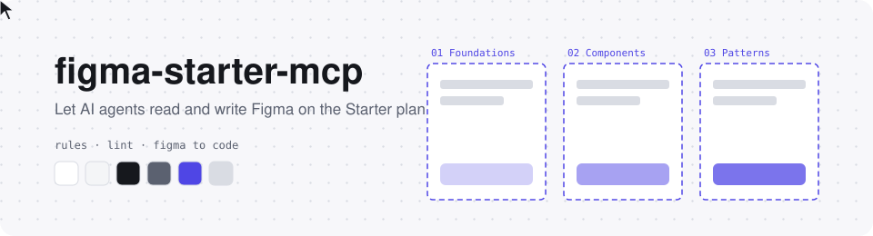

<div align="center">

<picture>
  <source media="(prefers-color-scheme: dark)" srcset=".github/assets/banner-dark.svg">
  
</picture>

# figma-starter-mcp

**A local MCP bridge that lets AI coding agents read and write Figma**
<br>A developer-friendly workflow that enforces variables, auto layout and code-matching names at the moment of writing

[](https://github.com/java-jaydev/figma-starter-mcp/stargazers)
[](LICENSE)
[](#limits)
<br>
[](#claude-code)
[](#codex)
[](#gemini-cli)
[](#grok-build)

[한국어](README.md) · **English** · [日本語](README.ja.md) · [简体中文](README.zh.md)

[What it is](#what) · [Install](#install) · [First run](#first-run) · [Rules](#rules) · [Starter limits](#limits) · [Security](#security) · [Notice](#legal) · [Workshop](#workshop) · [Structure](#structure)

</div>

---

> [!TIP]
> If this tool helps you, give it a tiny ⭐ at the top right. Every star helps it grow a little taller 🌱
> 👉 https://github.com/java-jaydev/figma-starter-mcp

<a id="what"></a>

## ✨ What it is

A Node server (MCP) running on your computer connects to a Figma development plugin over a localhost WebSocket. Your AI coding agent reads and draws inside the Figma desktop app through MCP tools.

- **Rules enforced at write time**: colors, spacing and radii come from variables; variable names look like code tokens (`color/bg/default`); screens use auto layout; components use PascalCase names and camelCase props. The write tools block or flag values that break these rules on the spot.
- **lint**: the `lint` tool checks the current page or selection against 7 rules, and values that must break a rule carry a reason through an exception syntax.
- **Figma to code**: read a selected frame and map variable names to your project tokens and components and properties to your existing code components and props.
- **One undo**: `batch` runs up to 100 commands in one go and undoes them in one step.

The skills (`figma-build`, `figma-to-code`) teach the agent this order. After installing, just say "draw a login screen in Figma" or "turn the selected frame into React".

<a id="install"></a>

## 📦 Install

You need Node.js (for npx) and the Figma desktop app. All four tools use the same server command (`npx -y github:java-jaydev/figma-starter-mcp#v0.1.1`).

<a id="claude-code"></a>
<details open>
<summary><b>Claude Code</b> (plugin: MCP server + skills)</summary>

```text
/plugin marketplace add java-jaydev/figma-starter-mcp
/plugin install figma-starter@figma-starter-mcp
```

The repo's `.mcp.json` registers the MCP server.

</details>

<a id="codex"></a>
<details>
<summary><b>Codex</b> (register MCP server + copy skills)</summary>

```bash
codex mcp add figma-starter -- npx -y github:java-jaydev/figma-starter-mcp#v0.1.1
git clone https://github.com/java-jaydev/figma-starter-mcp.git
mkdir -p ~/.agents/skills
cp -R figma-starter-mcp/skills/* ~/.agents/skills/
```

Details and verification status: [Install on Codex](docs/install/codex.en.md)

</details>

<a id="gemini-cli"></a>
<details>
<summary><b>Gemini CLI</b> (extension: MCP server + skills)</summary>

```bash
gemini extensions install https://github.com/java-jaydev/figma-starter-mcp
```

`gemini-extension.json` registers the MCP server. Whether `skills/` is discovered automatically is not verified yet.

</details>

<a id="grok-build"></a>
<details>
<summary><b>Grok Build</b> (register MCP server + copy skills)</summary>

```bash
grok mcp add figma-starter -- npx -y github:java-jaydev/figma-starter-mcp#v0.1.1
git clone https://github.com/java-jaydev/figma-starter-mcp.git
mkdir -p ~/.agents/skills
cp -R figma-starter-mcp/skills/* ~/.agents/skills/
```

Details and verification status: [Install on Grok Build](docs/install/grok.en.md)

</details>

<a id="first-run"></a>

## 🚀 First run

1. Find the plugin path.
   ```bash
   npx -y github:java-jaydev/figma-starter-mcp#v0.1.1 plugin-path
   ```
2. In the Figma desktop app, open **Plugins > Development > Import plugin from manifest** and pick the `manifest.json` at that path.
3. Run **Plugins > Development > figma-starter**.
4. Ask your AI agent "what is the figma-starter status?" to get the 6-character code from the `status` tool.
5. Enter that code in the plugin window.

You only pair once. To clear the pairing, run `npx -y github:java-jaydev/figma-starter-mcp#v0.1.1 unpair`, close all AI sessions, and start again.

<a id="rules"></a>

## 📐 Developer-friendly rules

| Rule id | What it keeps |
|---|---|
| `hardcoded-value` | colors, spacing, radii and font sizes come from variables or text styles |
| `token-name` | variable names are lowercase slash paths (`color/bg/default`) |
| `theme-mismatch` | light and dark variables share the same names |
| `missing-auto-layout` | frames use auto layout (flex) |
| `component-name`, `prop-name` | components in PascalCase, properties in camelCase |
| `default-layer-name` | no default names such as `Frame 12` |

**Variants**: v1 does not create variants. Make them by hand in Figma: select the components, then Combine as variants.

The full rules, including file structure (system, screens and sandbox pages with Sections) and the exception syntax, are in [rules.md](skills/figma-build/references/rules.md) (written in Korean).

<a id="limits"></a>

## 📊 Background: Figma free (Starter) plan limits

Facts that explain the situation this tool works in. Limits change often.

| Item | Starter | Source |
|---|---|---|
| Design files | 3 | [Compare Figma plans and features](https://help.figma.com/hc/en-us/articles/360040328273-Figma-plans-and-features) |
| Pages per file | 3 | [Create and manage pages](https://help.figma.com/hc/en-us/articles/360038511293-Create-and-manage-pages) |
| Variable modes | 1 per collection (observed; the official table is blank) | [Modes for variables](https://help.figma.com/hc/en-us/articles/15343816063383-Modes-for-variables) |
| Team library | Professional and up | [Compare Figma plans and features](https://help.figma.com/hc/en-us/articles/360040328273-Figma-plans-and-features) |
| Figma MCP server | up to 20 calls per month | [Rate limits & access](https://developers.figma.com/docs/figma-mcp-server/rate-limits-access/) |
| Development plugins | imported and run in the desktop app | [Plugin Quickstart Guide](https://developers.figma.com/docs/plugins/plugin-quickstart-guide/) |

> [!IMPORTANT]
> Checked 2026-11-10. All numbers and sources live in one place: [limits and sources](skills/figma-build/references/limits-and-sources.md) (written in Korean).

<a id="legal"></a>

## ⚖️ Figma terms and notice

This tool is not affiliated with or endorsed by Figma. Please read the following before use.

- This plugin is **never submitted to the Figma Community.** It is installed only as a development plugin (Import plugin from manifest).
- Figma's [plugin review guidelines](https://help.figma.com/hc/en-us/articles/360039958914-Plugin-and-widget-review-guidelines) list plugins Figma generally does not approve, including "Expose an MCP server through a plugin, or otherwise provide programmatic AI access to Figma files outside our official MCP server". They also say "We may not approve plugins or widgets that function as a workaround to Figma's paid offerings". This tool is close to that shape, so it is not published to the Community.
- You use it at your own risk under Figma's terms (such as the [Acceptable Use Policy](https://www.figma.com/legal/aup/)) and make that judgment yourself. If you are unsure whether it is allowed, ask Figma directly.

<a id="security"></a>

## 🔒 Security notes

- **Localhost only**: the server listens on `127.0.0.1` only. The plugin manifest allows only `ws://localhost:39917`. Figma rejects IP addresses in `devAllowedDomains`.
- **Pairing**: you enter a 6-character code once, and the server and plugin verify each other through a challenge-response.
- **Secrets protected**: after pairing, secrets are never sent again, and every later command is signed.
- **Pairing throttle**: wrong-code attempts are throttled.
- **Delete confirmations**: deleting 5 or more nodes, 50 or more layers counting everything inside, or any component makes the plugin ask the user first.
- **Accepted residual risk**: during the first pairing, a program that grabbed the port first could brute-force the 6-character code offline. **Pair only when you started the server yourself.**

<a id="workshop"></a>

## 🎓 2-hour workshop

The original course material is kept as a [2-hour workshop](docs/workshop/en/course-outline.md), with [labs](docs/workshop/en/labs.md) and a practice plugin in `docs/workshop/token-plugin/`.

<a id="structure"></a>

## 🗂️ Folder structure

```text
.
├── src/server/              MCP server (stdio) and localhost hub
├── src/plugin/              Figma development plugin (manifest.json, code, ui)
├── src/shared/              protocol and rules shared by server and plugin
├── skills/
│   ├── figma-build/         draw screens and tokens (references/rules.md, limits-and-sources.md)
│   └── figma-to-code/       Figma to code
├── .claude-plugin/          Claude Code marketplace and plugin config
├── .mcp.json                MCP server registration for Claude Code
├── gemini-extension.json    Gemini CLI extension config
├── docs/install/            Codex and Grok Build install notes
├── docs/workshop/           2-hour workshop material
└── tests/                   vitest tests (npm test)
```

## 🤝 Contributing

Typos, changed limits and better translations are all welcome. When you change a limit value, include the official source link and the check date.

<div align="center">

---

MIT License · This tool is a personal project unaffiliated with Figma.
<br>A ⭐ really makes my day!

</div>
