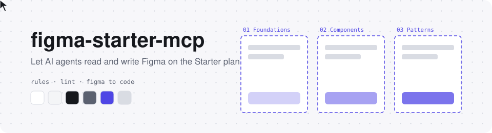

<div align="center">

<picture>
  <source media="(prefers-color-scheme: dark)" srcset=".github/assets/banner-dark.svg">
  
</picture>

# figma-starter-mcp

**AI コーディングエージェントが Figma を読み書きするためのローカル MCP ブリッジ**
<br>変数、オートレイアウト、コードと同じ命名を、書き込む瞬間に守らせる開発者向けワークフロー

[](https://github.com/java-jaydev/figma-starter-mcp/stargazers)
[](LICENSE)
[](#limits)
<br>
[](#claude-code)
[](#codex)
[](#gemini-cli)
[](#grok-build)

[한국어](README.md) · [English](README.en.md) · **日本語** · [简体中文](README.zh.md)

[これは何か](#what) · [インストール](#install) · [初回起動](#first-run) · [ルール](#rules) · [無料プランの上限](#limits) · [セキュリティ](#security) · [お知らせ](#legal) · [ワークショップ](#workshop) · [フォルダ構成](#structure)

</div>

---

> [!TIP]
> このツールが役に立ったら、右上の ⭐ をポチッと押してください。星ひとつでツールがすくすく育ちます 🌱
> 👉 https://github.com/java-jaydev/figma-starter-mcp

<a id="what"></a>

## ✨ これは何か

自分のコンピューターで動く Node サーバー (MCP) と Figma の開発用プラグインが、localhost の WebSocket でつながります。AI コーディングエージェントは MCP ツールを通して、Figma デスクトップアプリの中のファイルを読み、描きます。

- **ルールを書き込む瞬間に強制**: 色、余白、角丸は変数から、変数名は `color/bg/default` のようなコードのトークン名で、画面はオートレイアウトで、コンポーネントは PascalCase の名前と camelCase の props で。書き込みツールは、ルールに反する値をその場で止めるか知らせます。
- **lint**: `lint` ツールが現在のページか選択範囲を 7 つのルールで検査します。守れない値は、理由を残す例外構文で扱います。
- **Figma からコードへ**: 選択したフレームを読み、変数名はプロジェクトのトークンに、コンポーネントとプロパティは既存のコードコンポーネントと props に対応づけてコードにします。
- **undo は 1 回**: `batch` で最大 100 個のコマンドをまとめて実行し、まとめて元に戻せます。

スキル (`figma-build`、`figma-to-code`) がエージェントにこの手順を教えます。インストールしたら「Figma にログイン画面を描いて」「選択したフレームを React にして」と話しかけるだけです。

<a id="install"></a>

## 📦 インストール

必要なもの: Node.js (npx)、Figma デスクトップアプリ。4 つのツールすべてが同じサーバーコマンド (`npx -y github:java-jaydev/figma-starter-mcp#v0.1.0`) を使います。

<a id="claude-code"></a>
<details open>
<summary><b>Claude Code</b> (プラグイン: MCP サーバー + スキル)</summary>

```text
/plugin marketplace add java-jaydev/figma-starter-mcp
/plugin install figma-starter@figma-starter-mcp
```

リポジトリの `.mcp.json` が MCP サーバーを登録します。

</details>

<a id="codex"></a>
<details>
<summary><b>Codex</b> (MCP サーバー登録 + スキルをコピー)</summary>

```bash
codex mcp add figma-starter -- npx -y github:java-jaydev/figma-starter-mcp#v0.1.0
git clone https://github.com/java-jaydev/figma-starter-mcp.git
mkdir -p ~/.agents/skills
cp -R figma-starter-mcp/skills/* ~/.agents/skills/
```

詳細と確認状況: [Codex へのインストール](docs/install/codex.ja.md)

</details>

<a id="gemini-cli"></a>
<details>
<summary><b>Gemini CLI</b> (拡張: MCP サーバー + スキル)</summary>

```bash
gemini extensions install https://github.com/java-jaydev/figma-starter-mcp
```

`gemini-extension.json` が MCP サーバーを登録します。`skills/` が自動で見つかるかはまだ確認できていません (未確認)。

</details>

<a id="grok-build"></a>
<details>
<summary><b>Grok Build</b> (MCP サーバー登録 + スキルをコピー)</summary>

```bash
grok mcp add figma-starter -- npx -y github:java-jaydev/figma-starter-mcp#v0.1.0
git clone https://github.com/java-jaydev/figma-starter-mcp.git
mkdir -p ~/.agents/skills
cp -R figma-starter-mcp/skills/* ~/.agents/skills/
```

詳細と確認状況: [Grok Build へのインストール](docs/install/grok.ja.md)

</details>

<a id="first-run"></a>

## 🚀 初回起動

1. プラグインのパスを確認します。
   ```bash
   npx -y github:java-jaydev/figma-starter-mcp#v0.1.0 plugin-path
   ```
2. Figma デスクトップアプリで **Plugins > Development > Import plugin from manifest** を開き、そのパスの `manifest.json` を選びます。
3. **Plugins > Development > figma-starter** を実行します。
4. AI エージェントに「figma-starter の状態を教えて」と頼み、`status` ツールが返す 6 文字のコードを受け取ります。
5. プラグインのウィンドウにそのコードを入力します。

接続は 1 回だけで済みます。ペアリングを消すには `npx -y github:java-jaydev/figma-starter-mcp#v0.1.0 unpair` を実行し、AI セッションをすべて閉じてからもう一度始めてください。

<a id="rules"></a>

## 📐 開発者向けルール

| ルール id | 守ること |
|---|---|
| `hardcoded-value` | 色、余白、角丸、フォントサイズは変数かテキストスタイルで |
| `token-name` | 変数名は小文字のスラッシュ区切り (`color/bg/default`) |
| `theme-mismatch` | ライトとダークの変数名を同じに |
| `missing-auto-layout` | フレームはオートレイアウト (flex) |
| `component-name`、`prop-name` | コンポーネントは PascalCase、プロパティは camelCase |
| `default-layer-name` | `Frame 12` のような初期名は禁止 |

**バリアント**: v1 はバリアントを作りません。Figma でコンポーネントを選択し、Combine as variants で手作業で作ってください。

ファイル構成 (システム、画面、実験場ページと Section) や例外構文を含む全ルールは [rules.md](skills/figma-build/references/rules.md) (韓国語) にあります。

<a id="limits"></a>

## 📊 背景: Figma 無料 (Starter) プランの上限

このツールが置かれた状況を理解するための事実の整理です。上限はよく変わります。

| 項目 | Starter | 出典 |
|---|---|---|
| デザインファイル | 3 つ | [Compare Figma plans and features](https://help.figma.com/hc/en-us/articles/360040328273-Figma-plans-and-features) |
| ファイルあたりのページ | 3 ページ | [Create and manage pages](https://help.figma.com/hc/en-us/articles/360038511293-Create-and-manage-pages) |
| 変数のモード | コレクションあたり 1 つ (実測。公式の表は空欄) | [Modes for variables](https://help.figma.com/hc/en-us/articles/15343816063383-Modes-for-variables) |
| チームライブラリ | Professional から | [Compare Figma plans and features](https://help.figma.com/hc/en-us/articles/360040328273-Figma-plans-and-features) |
| Figma MCP サーバー | 月最大 20 回 | [Rate limits & access](https://developers.figma.com/docs/figma-mcp-server/rate-limits-access/) |
| 開発用プラグイン | デスクトップアプリで読み込んで実行 | [Plugin Quickstart Guide](https://developers.figma.com/docs/plugins/plugin-quickstart-guide/) |

> [!IMPORTANT]
> 確認日 2026-11-10。数値と出典は [上限と出典](skills/figma-build/references/limits-and-sources.md) (韓国語) の 1 か所で管理しています。

<a id="legal"></a>

## ⚖️ Figma の規約とお知らせ

このツールは Figma と無関係で、Figma が推奨するものでもありません。使う前に次をお読みください。

- このプラグインは **Figma Community に提出しません。** 開発用プラグイン (Import plugin from manifest) としてのみインストールします。
- Figma の [プラグイン審査ガイドライン](https://help.figma.com/hc/en-us/articles/360039958914-Plugin-and-widget-review-guidelines) は、原則として承認しないプラグインに "Expose an MCP server through a plugin, or otherwise provide programmatic AI access to Figma files outside our official MCP server" を挙げています。さらに "We may not approve plugins or widgets that function as a workaround to Figma's paid offerings" とも書かれています。このツールはそれに近い形なので、Community には公開しません。
- 利用に伴うリスクは、Figma の規約 ([Acceptable Use Policy](https://www.figma.com/legal/aup/) など) に従い、利用者自身が判断して負います。許可されるか不安なときは Figma に直接問い合わせてください。

<a id="security"></a>

## 🔒 セキュリティノート

- **localhost のみ**: サーバーは `127.0.0.1` だけで待ち受けます。プラグインのマニフェストも `ws://localhost:39917` と `ws://127.0.0.1:39917` だけを許可します。
- **ペアリング**: 6 文字のコードを 1 回入力し、サーバーとプラグインが challenge-response で互いを確認します。
- **秘密値の保護**: ペアリング後は秘密値を二度と送らず、以降のコマンドは署名して送ります。
- **ペアリング試行の制限**: コードの入力ミスには throttle がかかります。
- **削除の確認**: 5 ノード以上の削除、内側のレイヤーを含めて 50 レイヤー以上の削除、コンポーネントの削除は、プラグインが先にユーザーへ確認します。
- **残っているリスク**: 最初のペアリングの間、先にポートを取った別のプログラムが 6 文字のコードをオフラインで総当たりできます。**自分でサーバーを起動したときだけペアリングしてください。**

<a id="workshop"></a>

## 🎓 2 時間ワークショップ

以前の講座資料は [2 時間ワークショップ](docs/workshop/ja/course-outline.md) として残してあります。[実習ガイド](docs/workshop/ja/labs.md) と、`docs/workshop/token-plugin/` の実習用プラグインがあります。

<a id="structure"></a>

## 🗂️ フォルダ構成

```text
.
├── src/server/              MCP サーバー (stdio) と localhost ハブ
├── src/plugin/              Figma 開発用プラグイン (manifest.json, code, ui)
├── src/shared/              サーバーとプラグインが共有するプロトコルとルール
├── skills/
│   ├── figma-build/         画面とトークンを描く (references/rules.md, limits-and-sources.md)
│   └── figma-to-code/       Figma からコードへ
├── .claude-plugin/          Claude Code のマーケットプレイスとプラグイン設定
├── .mcp.json                Claude Code 用の MCP サーバー登録
├── gemini-extension.json    Gemini CLI 拡張の設定
├── docs/install/            Codex、Grok Build のインストール案内
├── docs/workshop/           2 時間ワークショップの資料
└── tests/                   vitest テスト (npm test)
```

## 🤝 コントリビュート

誤字、変わった上限、翻訳の改善、どれも歓迎です。上限の値を直すときは、公式の出典リンクと確認日を一緒に書いてください。

<div align="center">

---

MIT License · このツールは Figma と無関係な個人プロジェクトです。
<br>⭐ を押してもらえると本当に励みになります!

</div>
