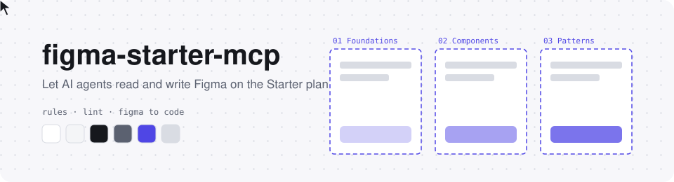

<div align="center">

<picture>
  <source media="(prefers-color-scheme: dark)" srcset=".github/assets/banner-dark.svg">
  
</picture>

# figma-starter-mcp

**AI 코딩 에이전트가 Figma 를 읽고 쓰게 하는 로컬 MCP 브리지**
<br>변수, 오토 레이아웃, 코드와 같은 이름 규칙을 쓰는 순간 지켜 주는 개발자 친화 워크플로

[](https://github.com/java-jaydev/figma-starter-mcp/stargazers)
[](LICENSE)
[](#limits)
<br>
[](#claude-code)
[](#codex)
[](#gemini-cli)
[](#grok-build)

**한국어** · [English](README.en.md) · [日本語](README.ja.md) · [简体中文](README.zh.md)

[무엇인가](#what) · [설치](#install) · [첫 실행](#first-run) · [규칙](#rules) · [무료 플랜 한도](#limits) · [보안](#security) · [고지](#legal) · [워크숍](#workshop) · [폴더 구조](#structure)

</div>

---

> [!TIP]
> 이 도구가 도움이 됐다면 오른쪽 위 ⭐ 를 콕 눌러 주세요. 별 하나에 도구가 한 뼘씩 자라요 🌱
> 👉 https://github.com/java-jaydev/figma-starter-mcp

<a id="what"></a>

## ✨ 무엇인가

내 컴퓨터에서 도는 Node 서버(MCP)와 Figma 개발용 플러그인이 localhost WebSocket 으로 연결됩니다. AI 코딩 에이전트는 MCP 도구로 Figma 데스크톱 앱 안의 파일을 읽고 그립니다.

- **규칙을 쓰는 순간 강제**: 색, 간격, 모서리는 변수로, 변수 이름은 `color/bg/default` 처럼 코드 토큰 이름으로, 화면은 오토 레이아웃으로, 컴포넌트는 PascalCase 이름과 camelCase props 로. 쓰기 도구가 이 규칙을 어기는 값을 그 자리에서 막거나 알립니다.
- **lint**: `lint` 도구가 현재 페이지나 선택 영역을 7가지 규칙으로 검사하고, 어길 수밖에 없는 값은 이유를 남기는 예외 문법을 씁니다.
- **Figma 에서 코드로**: 선택한 프레임을 읽어 변수 이름은 프로젝트 토큰에, 컴포넌트와 속성은 기존 코드 컴포넌트와 props 에 대응시켜 코드로 옮깁니다.
- **한 번의 undo**: `batch` 로 최대 100개 명령을 한 번에 실행하고 한 번에 되돌립니다.

스킬(`figma-build`, `figma-to-code`)이 에이전트에게 이 순서를 알려 줍니다. 설치한 뒤 "Figma 에 로그인 화면 그려줘" 또는 "선택한 프레임을 React 로 옮겨줘" 라고 말하면 됩니다.

<a id="install"></a>

## 📦 설치

필요한 것: Node.js(npx), Figma 데스크톱 앱. 네 가지 도구 모두 같은 서버 명령(`npx -y github:java-jaydev/figma-starter-mcp#v0.1.0`)을 씁니다.

<a id="claude-code"></a>
<details open>
<summary><b>Claude Code</b> (플러그인: MCP 서버 + 스킬)</summary>

```text
/plugin marketplace add java-jaydev/figma-starter-mcp
/plugin install figma-starter@figma-starter-mcp
```

레포의 `.mcp.json` 이 MCP 서버를 등록합니다.

</details>

<a id="codex"></a>
<details>
<summary><b>Codex</b> (MCP 서버 등록 + 스킬 복사)</summary>

```bash
codex mcp add figma-starter -- npx -y github:java-jaydev/figma-starter-mcp#v0.1.0
git clone https://github.com/java-jaydev/figma-starter-mcp.git
mkdir -p ~/.agents/skills
cp -R figma-starter-mcp/skills/* ~/.agents/skills/
```

자세한 설명과 확인 상태: [Codex 설치](docs/install/codex.md)

</details>

<a id="gemini-cli"></a>
<details>
<summary><b>Gemini CLI</b> (확장: MCP 서버 + 스킬)</summary>

```bash
gemini extensions install https://github.com/java-jaydev/figma-starter-mcp
```

`gemini-extension.json` 이 MCP 서버를 등록합니다. `skills/` 를 자동으로 찾는지는 아직 확인하지 못했습니다(미확인).

</details>

<a id="grok-build"></a>
<details>
<summary><b>Grok Build</b> (MCP 서버 등록 + 스킬 복사)</summary>

```bash
grok mcp add figma-starter -- npx -y github:java-jaydev/figma-starter-mcp#v0.1.0
git clone https://github.com/java-jaydev/figma-starter-mcp.git
mkdir -p ~/.agents/skills
cp -R figma-starter-mcp/skills/* ~/.agents/skills/
```

자세한 설명과 확인 상태: [Grok Build 설치](docs/install/grok.md)

</details>

<a id="first-run"></a>

## 🚀 첫 실행

1. 플러그인 경로를 확인합니다.
   ```bash
   npx -y github:java-jaydev/figma-starter-mcp#v0.1.0 plugin-path
   ```
2. Figma 데스크톱 앱에서 **Plugins > Development > Import plugin from manifest** 를 열고 위 경로의 `manifest.json` 을 고릅니다.
3. **Plugins > Development > figma-starter** 를 실행합니다.
4. AI 에이전트에게 "figma-starter 상태 알려줘" 라고 해서 `status` 도구가 주는 6자리 코드를 받습니다.
5. 플러그인 창에 그 코드를 입력합니다.

연결은 한 번만 하면 됩니다. 페어링을 지우려면 `npx -y github:java-jaydev/figma-starter-mcp#v0.1.0 unpair` 를 실행하고 AI 세션을 모두 닫았다가 다시 시작하세요.

<a id="rules"></a>

## 📐 개발 친화 규칙

| 규칙 id | 지키는 것 |
|---|---|
| `hardcoded-value` | 색, 간격, 모서리, 글꼴 크기는 변수나 텍스트 스타일로 |
| `token-name` | 변수 이름은 소문자 슬래시 경로 (`color/bg/default`) |
| `theme-mismatch` | 라이트/다크 변수 이름이 같아야 함 |
| `missing-auto-layout` | 프레임은 오토 레이아웃 (flex) |
| `component-name`, `prop-name` | 컴포넌트는 PascalCase, 속성은 camelCase |
| `default-layer-name` | `Frame 12` 같은 기본 이름 금지 |

**Variant**: v1 은 variant 를 만들지 않습니다. Figma 에서 컴포넌트들을 선택하고 Combine as variants 로 직접 만드세요.

파일 구조(시스템, 화면, 실험장 페이지와 Section)와 예외 문법까지 포함한 전체 규칙은 [rules.md](skills/figma-build/references/rules.md) 에 있습니다.

<a id="limits"></a>

## 📊 배경: Figma 무료(Starter) 플랜 한도

이 도구가 해결하려는 상황을 이해하는 데 도움이 되는 사실 정리입니다. 한도는 수시로 바뀝니다.

| 항목 | Starter | 출처 |
|---|---|---|
| 디자인 파일 | 3개 | [Compare Figma plans and features](https://help.figma.com/hc/en-us/articles/360040328273-Figma-plans-and-features) |
| 파일당 페이지 | 3개 | [Create and manage pages](https://help.figma.com/hc/en-us/articles/360038511293-Create-and-manage-pages) |
| 변수 모드 | 컬렉션당 1개 (실측, 공식 표는 비어 있음) | [Modes for variables](https://help.figma.com/hc/en-us/articles/15343816063383-Modes-for-variables) |
| 팀 라이브러리 | Professional 부터 | [Compare Figma plans and features](https://help.figma.com/hc/en-us/articles/360040328273-Figma-plans-and-features) |
| Figma MCP 서버 | 월 최대 20회 | [Rate limits & access](https://developers.figma.com/docs/figma-mcp-server/rate-limits-access/) |
| 개발용 플러그인 | 데스크톱 앱에서 불러와 실행 | [Plugin Quickstart Guide](https://developers.figma.com/docs/plugins/plugin-quickstart-guide/) |

> [!IMPORTANT]
> 확인일 2026-11-10. 모든 숫자와 출처는 [한도와 출처](skills/figma-build/references/limits-and-sources.md) 한 곳에서 관리합니다.

<a id="legal"></a>

## ⚖️ Figma 이용 약관과 고지

이 도구는 Figma 와 관련이 없고, Figma 가 보증하지 않습니다. 사용 전에 아래를 꼭 읽어 주세요.

- 이 플러그인은 **Figma Community 에 제출하지 않습니다.** 개발용 플러그인(Import plugin from manifest)으로만 설치합니다.
- Figma 의 [플러그인 심사 가이드라인](https://help.figma.com/hc/en-us/articles/360039958914-Plugin-and-widget-review-guidelines)은 승인하지 않는 플러그인으로 "Expose an MCP server through a plugin, or otherwise provide programmatic AI access to Figma files outside our official MCP server" 를 들고 있습니다. 또 "We may not approve plugins or widgets that function as a workaround to Figma's paid offerings" 라고도 적혀 있습니다. 이 도구는 그 모양에 가까워서 Community 에 올리지 않습니다.
- 사용에 따른 위험은 사용자가 Figma 의 약관([Acceptable Use Policy](https://www.figma.com/legal/aup/) 등)에 따라 스스로 판단하고 감수합니다. 허용 여부가 걱정되면 Figma 에 직접 문의하세요.

<a id="security"></a>

## 🔒 보안 노트

- **localhost 전용**: 서버는 `127.0.0.1` 에서만 받습니다. 플러그인 매니페스트도 `ws://localhost:39917`, `ws://127.0.0.1:39917` 만 허용합니다.
- **페어링**: 6자리 코드를 한 번 입력하고, 서버와 플러그인이 서로 상대를 확인하는 challenge-response 를 거칩니다.
- **비밀값 보호**: 페어링이 끝난 뒤에는 비밀값을 다시 보내지 않고, 이후 명령은 서명해서 보냅니다.
- **페어링 시도 제한**: 코드를 틀리게 입력하는 시도에는 throttle 이 걸립니다.
- **삭제 확인**: 노드 5개 이상 삭제, 안쪽 레이어까지 합쳐 50개 이상 삭제, 컴포넌트 삭제는 플러그인이 사용자에게 먼저 확인합니다.
- **남아 있는 위험**: 처음 페어링하는 순간, 먼저 포트를 잡은 다른 프로그램이 오프라인으로 6자리 코드를 무차별 대입할 수 있습니다. **서버를 직접 시작했을 때만 페어링하세요.**

<a id="workshop"></a>

## 🎓 2시간 워크숍

예전에 만든 강의 자료는 [2시간 워크숍](docs/workshop/ko/course-outline.md)으로 남겨 두었습니다. [실습 안내](docs/workshop/ko/labs.md)와 `docs/workshop/token-plugin/` 의 실습용 플러그인이 있습니다.

<a id="structure"></a>

## 🗂️ 폴더 구조

```text
.
├── src/server/              MCP 서버 (stdio) 와 localhost 허브
├── src/plugin/              Figma 개발용 플러그인 (manifest.json, code, ui)
├── src/shared/              서버와 플러그인이 공유하는 프로토콜과 규칙
├── skills/
│   ├── figma-build/         화면과 토큰 그리기 (references/rules.md, limits-and-sources.md)
│   └── figma-to-code/       Figma 에서 코드로
├── .claude-plugin/          Claude Code 마켓플레이스와 플러그인 설정
├── .mcp.json                Claude Code 용 MCP 서버 등록
├── gemini-extension.json    Gemini CLI 확장 설정
├── docs/install/            Codex, Grok Build 설치 안내
├── docs/workshop/           2시간 워크숍 자료
└── tests/                   vitest 테스트 (npm test)
```

## 🤝 기여

오타, 바뀐 한도, 번역 개선 모두 환영합니다. 한도 값을 고칠 때는 공식 출처 링크와 확인일을 함께 적어 주세요.

<div align="center">

---

MIT License · 이 도구는 Figma 와 관계없는 개인 프로젝트입니다.
<br>⭐ 를 눌러 주시면 정말 힘이 나요!

</div>
