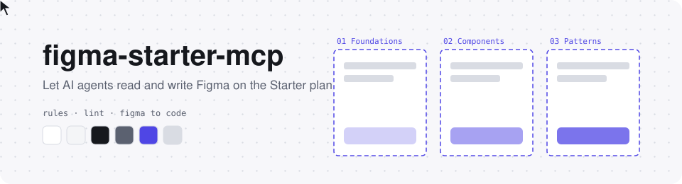

<div align="center">

<picture>
  <source media="(prefers-color-scheme: dark)" srcset=".github/assets/banner-dark.svg">
  
</picture>

# figma-starter-mcp

**让 AI 编程助手读写 Figma 的本地 MCP 桥接工具**
<br>在写入的那一刻就守住变量、自动布局和与代码一致的命名,面向开发者的工作流

[](https://github.com/java-jaydev/figma-starter-mcp/stargazers)
[](LICENSE)
[](#limits)
<br>
[](#claude-code)
[](#codex)
[](#gemini-cli)
[](#grok-build)

[한국어](README.md) · [English](README.en.md) · [日本語](README.ja.md) · **简体中文**

[这是什么](#what) · [安装](#install) · [首次运行](#first-run) · [规则](#rules) · [免费版限制](#limits) · [安全](#security) · [声明](#legal) · [工作坊](#workshop) · [目录结构](#structure)

</div>

---

> [!TIP]
> 如果这个工具对你有帮助,请点一下右上角的 ⭐。每一颗星都会让它长高一点点 🌱
> 👉 https://github.com/java-jaydev/figma-starter-mcp

<a id="what"></a>

## ✨ 这是什么

运行在你电脑上的 Node 服务器 (MCP) 与 Figma 开发插件通过 localhost WebSocket 相连。AI 编程助手借助 MCP 工具,在 Figma 桌面应用里读取并绘制文件。

- **写入时就强制执行规则**: 颜色、间距、圆角用变量,变量名用 `color/bg/default` 这样的代码 token 名,界面用自动布局,组件用 PascalCase 名称和 camelCase props。写入工具会当场拦截或提示违反规则的值。
- **lint**: `lint` 工具按 7 条规则检查当前页面或选中内容,不得不违反规则的值要用例外语法写明理由。
- **从 Figma 到代码**: 读取选中的框架,把变量名对应到项目的 token,把组件和属性对应到现有的代码组件和 props,再生成代码。
- **一次撤销**: `batch` 一次执行最多 100 条命令,也能一次撤销。

技能 (`figma-build`、`figma-to-code`) 会告诉助手这套流程。安装后直接说"在 Figma 里画一个登录界面"或"把选中的框架转成 React"即可。

<a id="install"></a>

## 📦 安装

需要: Node.js (npx) 和 Figma 桌面应用。四种工具都使用同一条服务器命令 (`npx -y github:java-jaydev/figma-starter-mcp#v0.1.0`)。

<a id="claude-code"></a>
<details open>
<summary><b>Claude Code</b> (插件: MCP 服务器 + 技能)</summary>

```text
/plugin marketplace add java-jaydev/figma-starter-mcp
/plugin install figma-starter@figma-starter-mcp
```

仓库里的 `.mcp.json` 会注册 MCP 服务器。

</details>

<a id="codex"></a>
<details>
<summary><b>Codex</b> (注册 MCP 服务器 + 复制技能)</summary>

```bash
codex mcp add figma-starter -- npx -y github:java-jaydev/figma-starter-mcp#v0.1.0
git clone https://github.com/java-jaydev/figma-starter-mcp.git
mkdir -p ~/.agents/skills
cp -R figma-starter-mcp/skills/* ~/.agents/skills/
```

详细说明和验证状态: [在 Codex 中安装](docs/install/codex.zh.md)

</details>

<a id="gemini-cli"></a>
<details>
<summary><b>Gemini CLI</b> (扩展: MCP 服务器 + 技能)</summary>

```bash
gemini extensions install https://github.com/java-jaydev/figma-starter-mcp
```

`gemini-extension.json` 会注册 MCP 服务器。`skills/` 是否会被自动发现尚未验证。

</details>

<a id="grok-build"></a>
<details>
<summary><b>Grok Build</b> (注册 MCP 服务器 + 复制技能)</summary>

```bash
grok mcp add figma-starter -- npx -y github:java-jaydev/figma-starter-mcp#v0.1.0
git clone https://github.com/java-jaydev/figma-starter-mcp.git
mkdir -p ~/.agents/skills
cp -R figma-starter-mcp/skills/* ~/.agents/skills/
```

详细说明和验证状态: [在 Grok Build 中安装](docs/install/grok.zh.md)

</details>

<a id="first-run"></a>

## 🚀 首次运行

1. 查看插件路径。
   ```bash
   npx -y github:java-jaydev/figma-starter-mcp#v0.1.0 plugin-path
   ```
2. 在 Figma 桌面应用中打开 **Plugins > Development > Import plugin from manifest**,选择该路径下的 `manifest.json`。
3. 运行 **Plugins > Development > figma-starter**。
4. 让 AI 助手"告诉我 figma-starter 的状态",从 `status` 工具拿到 6 位字符的配对码。
5. 在插件窗口中输入这个码。

只需配对一次。要清除配对,运行 `npx -y github:java-jaydev/figma-starter-mcp#v0.1.0 unpair`,关闭所有 AI 会话后再重新开始。

<a id="rules"></a>

## 📐 面向开发者的规则

| 规则 id | 要求 |
|---|---|
| `hardcoded-value` | 颜色、间距、圆角、字号使用变量或文本样式 |
| `token-name` | 变量名是小写的斜杠路径 (`color/bg/default`) |
| `theme-mismatch` | 浅色和深色的变量名保持一致 |
| `missing-auto-layout` | 框架使用自动布局 (flex) |
| `component-name`、`prop-name` | 组件用 PascalCase,属性用 camelCase |
| `default-layer-name` | 不用 `Frame 12` 这样的默认名称 |

**变体 (Variant)**: v1 不创建变体。请在 Figma 中选中组件,用 Combine as variants 手动创建。

完整规则 (包括文件结构: 系统、界面、试验场页面与 Section,以及例外语法) 见 [rules.md](skills/figma-build/references/rules.md) (韩语)。

<a id="limits"></a>

## 📊 背景: Figma 免费 (Starter) 版的限制

这是帮助理解本工具所处环境的事实整理。限制经常变动。

| 项目 | Starter | 来源 |
|---|---|---|
| 设计文件 | 3 个 | [Compare Figma plans and features](https://help.figma.com/hc/en-us/articles/360040328273-Figma-plans-and-features) |
| 每个文件的页面 | 3 页 | [Create and manage pages](https://help.figma.com/hc/en-us/articles/360038511293-Create-and-manage-pages) |
| 变量模式 | 每个集合 1 个 (实测,官方表格为空) | [Modes for variables](https://help.figma.com/hc/en-us/articles/15343816063383-Modes-for-variables) |
| 团队库 | Professional 起 | [Compare Figma plans and features](https://help.figma.com/hc/en-us/articles/360040328273-Figma-plans-and-features) |
| Figma MCP 服务器 | 每月最多 20 次 | [Rate limits & access](https://developers.figma.com/docs/figma-mcp-server/rate-limits-access/) |
| 开发插件 | 在桌面应用中导入并运行 | [Plugin Quickstart Guide](https://developers.figma.com/docs/plugins/plugin-quickstart-guide/) |

> [!IMPORTANT]
> 确认日期 2026-11-10。所有数字和来源集中在 [限制与来源](skills/figma-build/references/limits-and-sources.md) (韩语) 一处维护。

<a id="legal"></a>

## ⚖️ Figma 条款与声明

本工具与 Figma 无关,也未获得 Figma 的认可。使用前请先阅读以下内容。

- 这个插件**不会提交到 Figma Community。** 只作为开发插件 (Import plugin from manifest) 安装。
- Figma 的[插件审核指南](https://help.figma.com/hc/en-us/articles/360039958914-Plugin-and-widget-review-guidelines)把 "Expose an MCP server through a plugin, or otherwise provide programmatic AI access to Figma files outside our official MCP server" 列为一般不予批准的插件。指南还写道 "We may not approve plugins or widgets that function as a workaround to Figma's paid offerings"。本工具与这种形态相近,因此不发布到 Community。
- 使用风险由用户依照 Figma 的条款 (如 [Acceptable Use Policy](https://www.figma.com/legal/aup/)) 自行判断并承担。如果不确定是否被允许,请直接询问 Figma。

<a id="security"></a>

## 🔒 安全说明

- **仅限 localhost**: 服务器只监听 `127.0.0.1`。插件清单也只允许 `ws://localhost:39917` 和 `ws://127.0.0.1:39917`。
- **配对**: 输入一次 6 位字符的配对码,服务器和插件通过 challenge-response 互相验证。
- **保护密钥**: 配对完成后不再发送密钥,之后的命令都带签名。
- **配对尝试限速**: 输错配对码会被 throttle 限速。
- **删除确认**: 删除 5 个及以上节点、连同内部图层共 50 个及以上图层,或删除组件时,插件会先向用户确认。
- **已接受的剩余风险**: 首次配对期间,抢先占用该端口的程序可以离线暴力破解 6 位字符的配对码。**只在你自己启动了服务器时才进行配对。**

<a id="workshop"></a>

## 🎓 2 小时工作坊

早先的课程资料保留为 [2 小时工作坊](docs/workshop/zh/course-outline.md),包含 [实操指南](docs/workshop/zh/labs.md) 和 `docs/workshop/token-plugin/` 里的练习插件。

<a id="structure"></a>

## 🗂️ 目录结构

```text
.
├── src/server/              MCP 服务器 (stdio) 与 localhost hub
├── src/plugin/              Figma 开发插件 (manifest.json, code, ui)
├── src/shared/              服务器与插件共用的协议和规则
├── skills/
│   ├── figma-build/         绘制界面和 token (references/rules.md, limits-and-sources.md)
│   └── figma-to-code/       从 Figma 到代码
├── .claude-plugin/          Claude Code 市场与插件配置
├── .mcp.json                Claude Code 用的 MCP 服务器注册
├── gemini-extension.json    Gemini CLI 扩展配置
├── docs/install/            Codex、Grok Build 安装说明
├── docs/workshop/           2 小时工作坊资料
└── tests/                   vitest 测试 (npm test)
```

## 🤝 参与贡献

错别字、变动的限制、翻译改进都欢迎。修改限制数值时,请同时写上官方来源链接和确认日期。

<div align="center">

---

MIT License · 本工具是与 Figma 无关的个人项目。
<br>点一下 ⭐ 真的很有动力!

</div>
